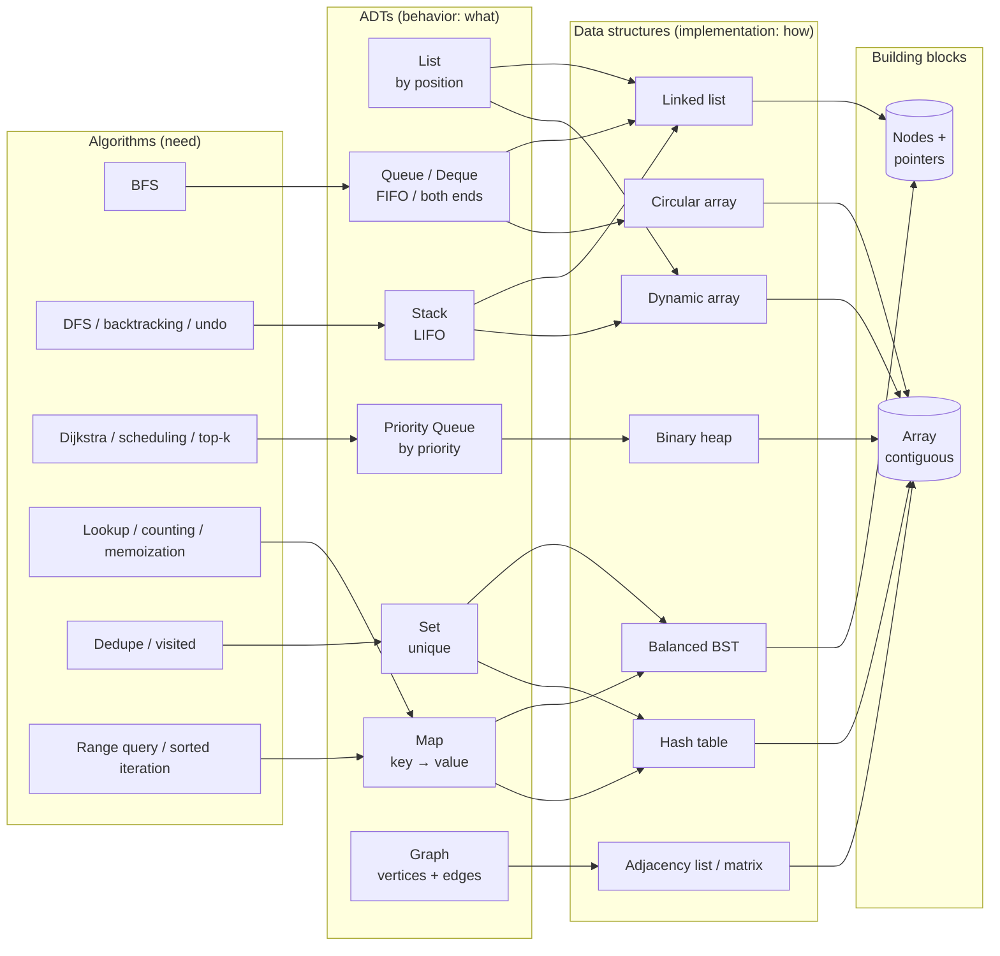

# ADT ↔ Data Structure Relationship Map

How everything connects in one place: **algorithms need behaviors (ADTs), behaviors are provided by implementations (data structures), and implementations are built from two building blocks (arrays and nodes).**

---

## 1. The Layers

```
 LAYER                QUESTION IT ANSWERS             EXAMPLES
 ─────────────────────────────────────────────────────────────────────────────
 Algorithm            "What steps solve it?"          BFS, DFS, Dijkstra, binary search, merge sort
     │ needs
     ▼
 ADT (behavior)       "What rules must the data       List, Stack, Queue, Deque, Set, Map,
                       follow?"                       Priority Queue, Tree, Graph
     │ implemented by
     ▼
 Data structure       "How is it actually stored?"    Dynamic array, Circular array, Linked list,
                                                      Hash table, Binary heap, BST, Adjacency list
     │ built from
     ▼
 Building block       "Where are the bytes?"          ARRAY (contiguous)  or  NODES + POINTERS
```

## 2. The Full Picture (diagram)



*(The diagram renders on GitHub, in VS Code with a Mermaid extension, and in Obsidian. If it shows as code, use the tables below, which have the same information.)*

## 3. ADT × Data Structure Matrix

**★ = the usual/best choice**, **✓ = works with a tradeoff**, **✗ = poor fit**, **blank = not used**

| ADT ↓ / Data structure → | Static array | Dynamic array | Circular array | Linked list | Hash table | Binary heap | Balanced BST |
|---|---|---|---|---|---|---|---|
| **List** | ✓ fixed size | ★ | | ✓ fast front ops | | | |
| **Stack** | ✓ can overflow | ★ use the end | | ✓ use the head | | | |
| **Queue** | ✗ shifting | ✗ `pop(0)` O(n) | ★ | ★ head + tail | | | |
| **Deque** | | ✗ | ★ (`deque`) | ✓ doubly linked | | | |
| **Set** | | ✗ O(n) contains | | ✗ O(n) | ★ fastest | | ✓ sorted |
| **Map** | | ✗ O(n) lookup | | ✗ | ★ fastest | | ✓ sorted |
| **Priority Queue** | | ✓ O(n) insert or extract | | ✗ | | ★ | ✓ O(log n), heavier |
| **Graph** | ✓ matrix (dense) | ★ adjacency list (sparse) | | ✓ adjacency list | ✓ dict of lists | | |

## 4. "Built On" Chains (memorize these)

```
ARRAY ──► Dynamic array ──► List, Stack
ARRAY ──► Circular array ──► Queue, Deque           (Python deque)
ARRAY ──► Binary heap ──► Priority Queue            (Python heapq, Java PriorityQueue)
ARRAY of buckets ──► Hash table ──► Map, Set        (Python dict/set, Java HashMap/HashSet)
NODES ──► Linked list ──► List, Stack, Queue
NODES ──► Balanced BST ──► Sorted Map / Sorted Set  (Java TreeMap/TreeSet)
ARRAY of LISTS ──► Adjacency list ──► Graph
2D ARRAY ──► Adjacency matrix ──► Graph
```

**Pattern:** most ADTs are built on an **array** in the end, because O(1) index access is so useful. Linked nodes are used when you need to grow or splice cheaply without shifting.

## 5. Algorithm → ADT It Needs

| Algorithm / task | Needs ADT | Because... | Typical DS |
|---|---|---|---|
| BFS, level-order traversal | Queue | Process in the order discovered (FIFO) | `deque` |
| DFS, backtracking, undo, bracket matching | Stack | Go back to the most recent item (LIFO) | `list` / call stack |
| Recursion | Stack | Every call is pushed onto the **call stack** | call stack (built in) |
| Dijkstra, Prim, A*, scheduling, top-k | Priority Queue | Always take the best item next | binary heap |
| Counting, caching, memoization, two-sum | Map | Look up by key in O(1) | hash table |
| Visited set, dedupe, membership | Set | Ask "seen it?" in O(1) | hash set |
| Range queries, sorted iteration, next-larger key | Sorted Map / Set | Order + O(log n) | balanced BST |
| Binary search | List (sorted) | Needs O(1) index access | array |
| Heap sort | Priority Queue | Repeatedly extract the max | binary heap (in place) |

## 6. One Example Through Every Layer
**"Undo in a text editor"**
- **Algorithm:** reverse the most recent action first
- **ADT:** Stack (LIFO), with operations push / pop
- **Data structure:** dynamic array, using its end
- **Building block:** array
- **Big O:** push O(1) amortized, pop O(1)
- **Tradeoff:** a linked-list stack is also O(1), but uses more memory per item. To cap the history at N actions, use a **deque with maxlen** (it drops the oldest from the other end)

---

Next: [Tradeoffs & Choosing ADT + DS](02_tradeoffs_decision_guide.md) → [Why It Matters: Cost - Time - Quality](03_why_it_matters_cost_time_quality.md)
